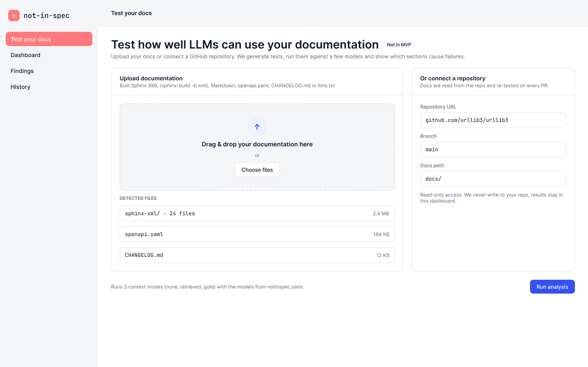
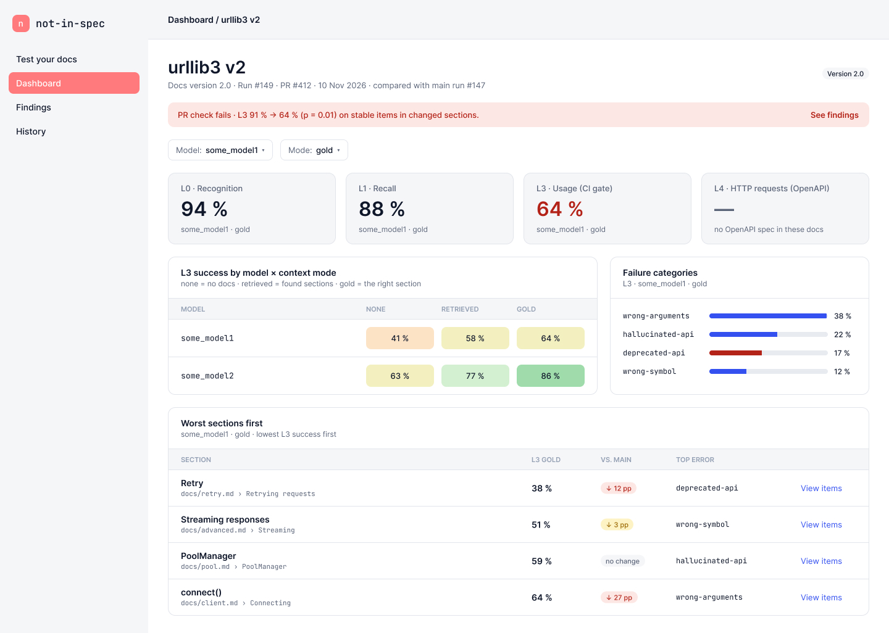
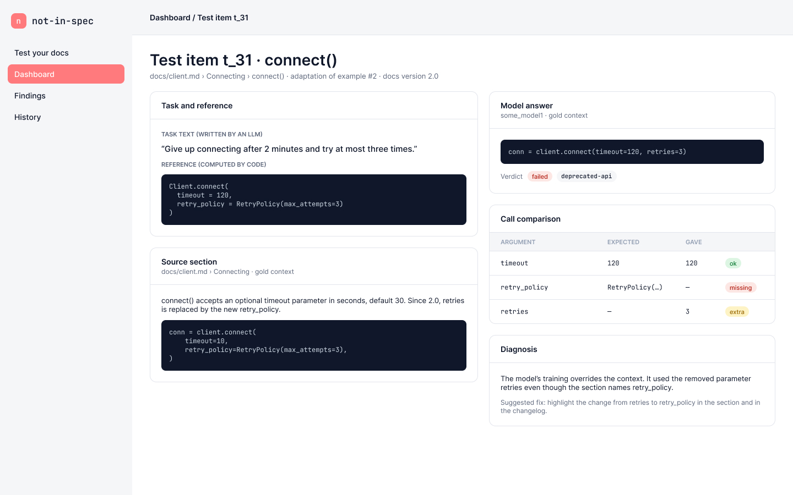
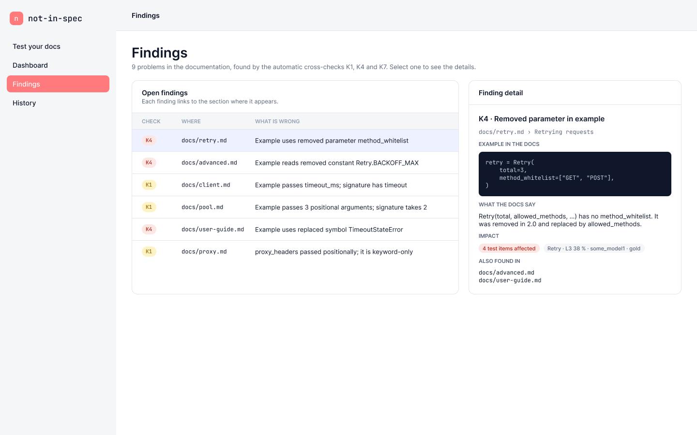
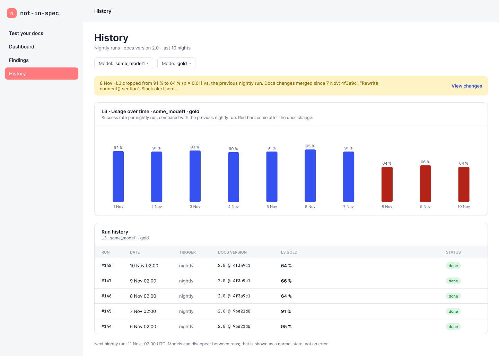

# Web UI design

Target screens for the web UI (`web/`). Follow them where they agree with [SPEC](../SPEC.md); where a screen differs from it, the SPEC wins. Screen 1 is not MVP. The numbers and names in the screens are sample data.

Rules for every screen:
- Every number belongs to one **level, model and mode** (SPEC §1, item 8). A screen that shows one number per level says which model and mode it is, or follows a model and mode selector. Levels, models and modes are never averaged, and there is never a single overall score.
- Pass / fail comes from the run's stored `verdict` (SPEC §11.1), never from comparing percentages in the browser.
- No fix recommendations ([SPEC §6.11](../SPEC.md#611-diagnosis)).

## 1. Test your docs

The entry page. The user uploads **built** documentation (Sphinx XML from `sphinx-build -b xml`, Markdown, `openapi.yaml`, `CHANGELOG.md`, `llms.txt`) or connects a GitHub repository by URL, branch and docs path, then starts the analysis with **Run analysis**.

*Future state, not MVP.* In the MVP the web UI is read-only and runs start only from the GitHub Action ([SPEC §1.1](../SPEC.md#11-what-we-are-not-building), [§11.1](../SPEC.md#111-upload-api)). Even then, an upload is never a Sphinx project (a zip of sources): our service never builds docs, it only parses built inputs (SPEC §1.1).

## 2. Run progress

A running analysis. It shows the pipeline steps (read & chunk, inventory, cross-checks, test generation, quality control, model runs, evaluation) with counts per step, an overall progress bar, and a live log. Quality control (SPEC §6.8: checks, round-trip solvers, review) runs before items are frozen and can take a while, so it has its own step.

## 3. Dashboard

Results of one run compared with its baseline (SPEC §7).
- **Level tiles:** L0, L1, L3 and, for OpenAPI docs, L4 (SPEC §16.1), each shown separately. They show **one model and one mode**, chosen with a selector above them (default: the first model of the run, `gold`).
- **L3 by model × context mode** (none, retrieved, gold) and **failure categories** of the selected model and mode.
- **Banner:** only on PR runs. It shows the run's stored verdict. When the check fails, it names the level, the change and its p-value, as the PR comment does (SPEC §2.4): "L3 · 91 % → 64 % (p = 0.01) on stable items in changed sections: the PR check fails." The build fails only on a statistically significant L3 / L4 drop on stable items in changed sections (SPEC §7), so the banner never appears just because a percentage went down. Nightly and main runs have no banner.
- **Worst sections first:** sorted by L3 success of the selected model and mode, lowest first, with the change against the baseline and the most common error.

## 4. Test item detail

One test item opened from the dashboard. It shows the task text (written by an LLM), the reference (computed by code), the source section, the model's answer with its verdict, an argument-by-argument comparison, and a diagnosis that says what the failure means. It never recommends a fix ([SPEC §6.11](../SPEC.md#611-diagnosis)); the docs author decides how to fix it.

## 5. Findings

Problems found in the docs by the automatic cross-checks (K1, K4 and K7 in the MVP, SPEC §16.1; more later), each linked to the file where it appears, where there is one: a K6 finding compares model results and has no single file. Selecting one shows the detail: the example from the docs, what the docs say instead, how many test items it affects, and where else it occurs. Findings of NLI checks (K2, K5) appear only after our team reviewed them (SPEC §6.5).

## 6. History

Nightly runs over time. A bar chart shows the L3 success rate per night of **one model and mode** (the same selector as on the dashboard) and marks the nights after a docs change. Each nightly run is compared with the previous nightly run, never with `main` (SPEC §7). A banner on a significant drop names the docs changes merged between the two nights, not a single commit: several main runs, or a model swapped behind a provider alias (SPEC §18), can fall between them. A table lists the runs with trigger, docs version and status.
