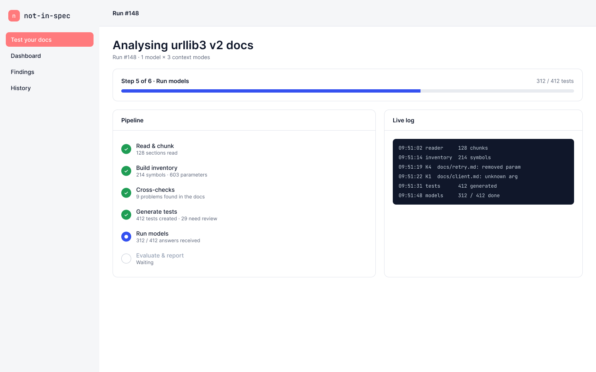

# Web UI design

Target screens for the web UI (`web/`). Follow them when working on the UI. The numbers and names in them are sample data. Where a screen differs from [SPEC](../SPEC.md), the SPEC wins.

## 1. Test your docs

The entry page. The user uploads documentation (Sphinx zip, Markdown, `openapi.yaml`, `CHANGELOG.md`, `llms.txt`) or connects a GitHub repository by URL, branch and docs path, then starts the analysis with **Run analysis**.

*Future state, not MVP.* In the MVP the web UI is read-only and runs start only from the GitHub Action ([SPEC §1.1](../SPEC.md#11-what-we-are-not-building), [§11.1](../SPEC.md#111-upload-api)).

## 2. Run progress

A running analysis. It shows the six pipeline steps (read & chunk, inventory, cross-checks, test generation, model runs, evaluation) with counts per step, an overall progress bar, and a live log.

## 3. Dashboard

Results of one run compared with `main`. It shows L0, L1 and L3 separately (never averaged), L3 by model × context mode (none, retrieved, gold), failure categories, and a table of the worst sections. A banner warns when L3 drops and the PR check would fail.

## 4. Test item detail

One test item opened from the dashboard. It shows the task text (written by an LLM), the reference (computed by code), the source section, the model's answer with its verdict, an argument-by-argument comparison, and a diagnosis that says what the failure means. It never recommends a fix ([SPEC §6.11](../SPEC.md#611-diagnosis)); the docs author decides how to fix it.

## 5. Findings

Problems found in the docs by the automatic cross-checks (K1–K7), each linked to the file where it appears. Selecting one shows the detail: the example from the docs, what the docs say instead, how many test items it affects, and where else it occurs.

## 6. History

Nightly runs over time. A bar chart shows the L3 success rate per night and marks the nights after a docs change. A banner names the commit that caused a drop, and a table lists the runs with trigger, docs version and status.
